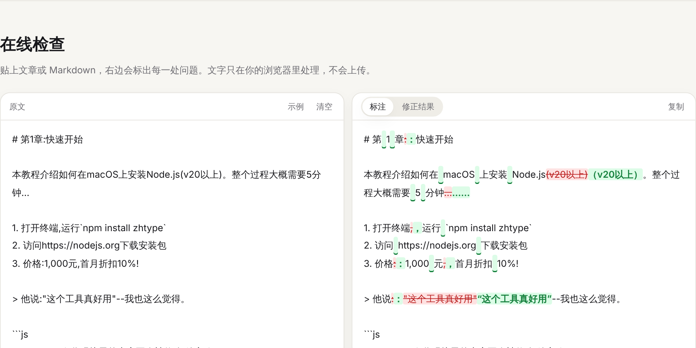

# paiban · 中文排版助手

A checker and fixer for Chinese typography. It adds the spaces between Chinese and Latin text, and fixes full-width punctuation, quotes, ellipses and dashes, while leaving code, links and HTML alone. Use it as a website, a command-line tool, a JavaScript library or a CI check.

The website also generates CSS for comfortable Chinese reading on the web: font stacks, line height, punctuation trimming and line breaking.



## What it fixes

<!-- paiban-disable -->
| Rule | Before | After |
|---|---|---|
| `space-between`: space between Chinese and Latin text or digits | 使用GitHub托管了3个项目 | 使用 GitHub 托管了 3 个项目 |
| `fullwidth-punct`: full-width punctuation in Chinese sentences | 你好,世界! | 你好，世界！ |
| `no-space-around-punct`: no spaces around full-width punctuation | 你好 ， 世界 。 | 你好，世界。 |
| `fullwidth-parens`: full-width parentheses around Chinese text | 开源(免费)软件 | 开源（免费）软件 |
| `ellipsis`: use “……” | 然后... | 然后…… |
| `dash`: use “——” | 这个问题--其实很简单 | 这个问题——其实很简单 |
| `quotes`: Chinese quotation marks (curly or corner) | 他说"你好" | 他说“你好” / 他说「你好」 |
| `halfwidth-alnum`: half-width letters and digits | ｉＰｈｏｎｅ１６ | iPhone16 |
| `repeated-punct` (off by default): no repeated punctuation | 太棒了！！！ | 太棒了！ |
<!-- paiban-enable -->

To skip part of a document, wrap it in `<!-- paiban-disable -->` and `<!-- paiban-enable -->`, or put `<!-- paiban-disable-next-line -->` above a line.

English-only text is never changed. In Markdown, fenced code blocks, inline code, front matter, URLs, e-mail addresses, link targets and HTML tags are skipped, and spaces are added around inline code and URLs (`` 运行`npm`安装 `` → `` 运行 `npm` 安装 ``).

## Command line

Requires Node.js 18 or newer.

```bash
npx paiban docs/                 # check every .md, .mdx and .txt file under docs/
npx paiban --fix README.md       # fix files in place
npx paiban --rules               # list the rules
echo "使用GitHub,很方便!" | npx paiban --stdin
```

| Option | |
|---|---|
| `--fix` | Write fixes back to the files |
| `--stdin` | Read from standard input and print the fixed text |
| `--quotes curly\|corner` | “Curly” quotes (default, mainland style) or 「corner」 quotes (Taiwan, Hong Kong) |
| `--enable <rules>` / `--disable <rules>` | Turn rules on or off, e.g. `--disable quotes,dash` |
| `--plain` | Treat files as plain text instead of Markdown |

`paiban` exits with code 1 when it finds problems, so it works as a CI check:

```yaml
- uses: actions/setup-node@v4
- run: npx paiban docs/
```

## JavaScript / TypeScript

```ts
import { check, fix } from "paiban";

fix("使用GitHub托管,很方便!");
// → "使用 GitHub 托管，很方便！"

fix('他说"你好"', { quotes: "corner", rules: { dash: false } });
// → "他说「你好」"

check("使用GitHub,很好");
// → [{ rule: "space-between", line: 1, column: 3, original: "", replacement: " ", ... }, ...]
```

`check` returns every problem with its rule, position and replacement; `fix` applies them all and returns the corrected text. Both take the same options: `rules`, `quotes` and `markdown`.

## Development

```bash
npm install
npm test             # rule tests (Vitest)
npm run typecheck
npm run build        # library and CLI into dist/
npm run dev          # website at http://localhost:5173
npm run build:site   # website into site/dist/
```

- `src/rules.ts`: the rules. Each one has an id, a title in both languages, an example and a `check` function that returns replacements.
- `src/protect.ts`: finds code, URLs and other text the rules must skip.
- `src/index.ts`: `check` and `fix`.
- `src/cli.ts`: the command-line tool.
- `site/`: the website (no framework, built with Vite).

Pushes to `main` run the tests and deploy the website to GitHub Pages (enable Pages with the source set to “GitHub Actions” in the repository settings).

## License

MIT
